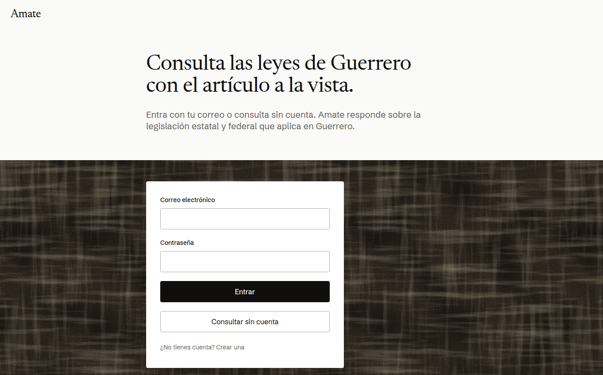

# RAG Legal Guerrero

> **In English:** open-source legal Q&A for lawyers in Guerrero, Mexico. Answers come from state and federal legislation, quote the article they rely on, and are replaced by a refusal when the quote cannot be found in the retrieved text. FastAPI, Qdrant, PostgreSQL, Ollama, React + TypeScript and Docker Compose, with 88 tests in CI and a [live demo](https://amate-demo.northcentralus.cloudapp.azure.com). The rest of this README is in Spanish.

Sistema RAG (Retrieval-Augmented Generation) 100% open source para asistir a abogados generalistas que ejercen en el Estado de Guerrero, México. Funciona como memoria de consulta rápida sobre legislación estatal y federal aplicable, devolviendo respuestas híbridas (resumen conversacional + fragmentos textuales exactos citando su fuente) para minimizar alucinaciones y facilitar la verificación por un profesional del derecho.

> **Este proyecto es un prototipo (MVP) en desarrollo activo.** No constituye asesoría legal. Ver [docs/aviso_privacidad.md](docs/aviso_privacidad.md) para la limitación de responsabilidad completa.

**Demo en línea:** <https://amate-demo.northcentralus.cloudapp.azure.com> (botón *Consultar sin cuenta*; corre en CPU, cada respuesta tarda alrededor de dos minutos).



**Tecnologías:** Python, FastAPI, Qdrant, PostgreSQL, Ollama, sentence-transformers, búsqueda híbrida con BM25, React + Vite + TypeScript, Docker Compose, Caddy, faster-whisper y Piper (voz), pytest y GitHub Actions.

## Principios del proyecto

1. **100% open source y sin APIs de pago** — modelos de HuggingFace, Ollama, y una base de datos vectorial libre.
2. **Contenerizado** — todo el stack corre vía Docker Compose.
3. **Docs-as-Code** — la documentación vive en este repositorio y evoluciona junto con el código, vía pull requests.

## Documentación

| Documento | Contenido |
|---|---|
| [docs/requerimientos_usuario.md](docs/requerimientos_usuario.md) | Alcance del MVP, funcionalidad esperada, restricciones del producto. |
| [docs/arquitectura.md](docs/arquitectura.md) | Diseño técnico: stack, cómputo cloud gratuito, flujo de una consulta. |
| [docs/security_checklist.md](docs/security_checklist.md) | Checklist de hardening de contenedores y prevención de prompt injection. |
| [docs/aviso_privacidad.md](docs/aviso_privacidad.md) | Aviso de privacidad y límite de responsabilidad (borrador, pendiente de revisión legal). |
| [docs/manual_ingenieria_software.md](docs/manual_ingenieria_software.md) | Justificación de cada decisión técnica en lenguaje accesible, buenas prácticas, y anexos de defensa legal (NDA, tratamiento de datos). |
| [docs/manual_usuario.md](docs/manual_usuario.md) | Guía de uso de la herramienta para el Product Owner (abogado). |
| [docs/spike_resultados.md](docs/spike_resultados.md) | Resultados de la validación técnica local del stack completo. |

## Cómo correr el proyecto en local

```bash
cp .env.example .env
# Editar .env y definir JWT_SECRET_KEY (generar con: python3 -c "import secrets; print(secrets.token_hex(32))")
docker compose up -d --build
docker compose exec ollama ollama pull qwen3.5:4b
docker compose exec backend python -m app.ingest       # corpus ficticio de prueba
docker compose exec backend python -m app.ingest_lft   # Ley Federal del Trabajo real (descarga el PDF oficial)
```

La interfaz queda disponible en `http://localhost:8080` — crea una cuenta desde la pantalla de inicio de sesión para poder usarla (todos los endpoints requieren autenticación).

### Con GPU NVIDIA (recomendado)

Con el [NVIDIA Container Toolkit](https://docs.nvidia.com/datacenter/cloud-native/container-toolkit/latest/install-guide.html)
instalado, agregar al `.env` la línea `COMPOSE_FILE=docker-compose.yml:docker-compose.gpu.yml`. Ollama corre
en la GPU y cada consulta tarda 3–5 s en lugar de ~40 s.

### Demo pública (link para el cliente, sin costo)

```bash
docker compose --profile demo up -d tunel
docker compose logs tunel | grep -o 'https://[a-z0-9-]*\.trycloudflare\.com'
```

El link sirve mientras la laptop esté encendida y cambia si el túnel reinicia. Para apagarlo:
`docker compose stop tunel`. Detalles en [docs/arquitectura.md](docs/arquitectura.md) §2.4. La demo para el cliente vive en la nube: [docs/despliegue_nube.md](docs/despliegue_nube.md).

## Cómo correr las pruebas

```bash
docker compose exec backend pytest tests/ -v
```

## Probar la API manualmente

Colección de [Bruno](https://www.usebruno.com/) (cliente de API open source) lista en
[`bruno/RAG-Legal-Guerrero`](bruno/RAG-Legal-Guerrero) — login, consultas de ejemplo, y una prueba
automatizada del mecanismo anti-alucinación. Ver [bruno/README.md](bruno/README.md).

## Ejemplo de uso

Consulta a la API de la demo con un acceso de invitado:

```bash
BASE=https://amate-demo.northcentralus.cloudapp.azure.com
TOKEN=$(curl -s -X POST $BASE/api/auth/invitado | jq -r .access_token)
curl -s -X POST $BASE/api/query \
  -H "Authorization: Bearer $TOKEN" -H "Content-Type: application/json" \
  -d '{"pregunta": "¿Cuántos días de aguinaldo debe pagar el patrón?", "area": "Laboral"}'
```

Respuesta real (recortada):

```json
{
  "respuesta": "El patrón debe pagar un aguinaldo equivalente a quince días de salario.\n\n«equivalente a quince días de salario, por lo menos» (Artículo 87)",
  "respaldada": true,
  "fragmentos": [
    {
      "fuente": "Artículo 87, Ley Federal del Trabajo (texto vigente, Cámara de Diputados del H. Congreso de la Unión)",
      "texto": "Los trabajadores tendrán derecho a un aguinaldo anual que deberá pagarse antes del día veinte de diciembre, equivalente a quince días de salario, por lo menos. ...",
      "score": 1.0
    }
  ]
}
```

`respaldada` indica que cada cita textual de la respuesta aparece literalmente en el fragmento del artículo citado. Si no se puede respaldar, la API responde «No cuento con la legislación necesaria en mi base de datos para responder a esta consulta.» en lugar de una respuesta sin fundamento.

## Estado actual

Stack completo (frontend + backend + Ollama + Qdrant + Postgres) desplegado en una VM de Azure (solo CPU) con HTTPS, autenticación multiusuario y acceso de invitado, rate limiting y 88 pruebas automatizadas que corren en cada push. Corpus real: legislación del Estado de Guerrero y la Ley Federal del Trabajo completa (texto oficial). Detalles y pendientes en [docs/despliegue_nube.md](docs/despliegue_nube.md) y en el roadmap de [docs/manual_ingenieria_software.md](docs/manual_ingenieria_software.md#10-roadmap-técnico-y-pendientes).

## Licencia

Este proyecto se distribuye bajo la licencia [Apache 2.0](LICENSE).
