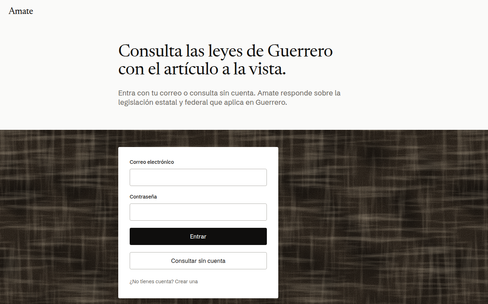

# RAG Legal Guerrero

A 100% open-source RAG (Retrieval-Augmented Generation) system that assists general-practice lawyers in the State of Guerrero, Mexico. It works as a quick-reference memory of applicable state and federal legislation. Each answer combines a conversational summary with exact excerpts that cite their source, which minimizes hallucinations and makes verification easy for a legal professional.

> **This project is a prototype (MVP) under active development.** It does not constitute legal advice. See [docs/aviso_privacidad.md](docs/aviso_privacidad.md) for the full limitation of liability.

**Live demo:** <https://amate-demo.northcentralus.cloudapp.azure.com> (use the *Consultar sin cuenta* button; it runs on CPU, so each answer takes about two minutes).



**Technologies:** Python, FastAPI, Qdrant, PostgreSQL, Ollama, sentence-transformers, hybrid search with BM25, React + Vite + TypeScript, Docker Compose, Caddy, faster-whisper and Piper (voice), pytest and GitHub Actions.

The interface and documentation are in Spanish, because the users are lawyers in Mexico.

## Project principles

1. **100% open source, no paid APIs:** HuggingFace models, Ollama and a free vector database.
2. **Containerized:** the whole stack runs through Docker Compose.
3. **Docs as code:** documentation lives in this repository and evolves with the code through pull requests.

## Documentation

| Document | Content |
|---|---|
| [docs/requerimientos_usuario.md](docs/requerimientos_usuario.md) | MVP scope, expected functionality and product constraints. |
| [docs/arquitectura.md](docs/arquitectura.md) | Technical design: stack, free cloud compute and the flow of a query. |
| [docs/security_checklist.md](docs/security_checklist.md) | Container hardening and prompt injection prevention checklist. |
| [docs/aviso_privacidad.md](docs/aviso_privacidad.md) | Privacy notice and limitation of liability (draft, pending legal review). |
| [docs/manual_ingenieria_software.md](docs/manual_ingenieria_software.md) | Rationale for each technical decision in plain language, best practices and legal defense annexes (NDA, data processing). |
| [docs/manual_usuario.md](docs/manual_usuario.md) | User guide for the Product Owner (a lawyer). |
| [docs/spike_resultados.md](docs/spike_resultados.md) | Results of the local technical validation of the full stack. |

## Running the project locally

```bash
cp .env.example .env
# Edit .env and set JWT_SECRET_KEY (generate it with: python3 -c "import secrets; print(secrets.token_hex(32))")
docker compose up -d --build
docker compose exec ollama ollama pull qwen3.5:4b
docker compose exec backend python -m app.ingest       # fictional test corpus
docker compose exec backend python -m app.ingest_lft   # real Federal Labor Law (downloads the official PDF)
```

The interface is available at `http://localhost:8080`. Create an account from the login screen to use it, since every endpoint requires authentication.

### With an NVIDIA GPU (recommended)

With the [NVIDIA Container Toolkit](https://docs.nvidia.com/datacenter/cloud-native/container-toolkit/latest/install-guide.html) installed, add the line `COMPOSE_FILE=docker-compose.yml:docker-compose.gpu.yml` to `.env`. Ollama then runs on the GPU and each query takes 3–5 s instead of about 40 s.

### Public demo (free client link)

```bash
docker compose --profile demo up -d tunel
docker compose logs tunel | grep -o 'https://[a-z0-9-]*\.trycloudflare\.com'
```

The link works while the laptop is on and changes if the tunnel restarts. To shut it down, run `docker compose stop tunel`. Details are in [docs/arquitectura.md](docs/arquitectura.md) §2.4. The client demo lives in the cloud: [docs/despliegue_nube.md](docs/despliegue_nube.md).

## Running the tests

```bash
docker compose exec backend pytest tests/ -v
```

## Trying the API manually

A [Bruno](https://www.usebruno.com/) collection (an open-source API client) is ready in [`bruno/RAG-Legal-Guerrero`](bruno/RAG-Legal-Guerrero), with login, sample queries and an automated test of the anti-hallucination mechanism. See [bruno/README.md](bruno/README.md).

## Usage example

Query the demo API with guest access. The question asks how many days of Christmas bonus an employer must pay:

```bash
BASE=https://amate-demo.northcentralus.cloudapp.azure.com
TOKEN=$(curl -s -X POST $BASE/api/auth/invitado | jq -r .access_token)
curl -s -X POST $BASE/api/query \
  -H "Authorization: Bearer $TOKEN" -H "Content-Type: application/json" \
  -d '{"pregunta": "¿Cuántos días de aguinaldo debe pagar el patrón?", "area": "Laboral"}'
```

Real response (trimmed):

```json
{
  "respuesta": "El patrón debe pagar un aguinaldo equivalente a quince días de salario.\n\n«equivalente a quince días de salario, por lo menos» (Artículo 87)",
  "respaldada": true,
  "fragmentos": [
    {
      "fuente": "Artículo 87, Ley Federal del Trabajo (texto vigente, Cámara de Diputados del H. Congreso de la Unión)",
      "texto": "Los trabajadores tendrán derecho a un aguinaldo anual que deberá pagarse antes del día veinte de diciembre, equivalente a quince días de salario, por lo menos. ...",
      "score": 1.0
    }
  ]
}
```

`respaldada` ("supported") means every verbatim quote in the answer appears literally in the fragment of the cited article. If an answer can't be supported, the API returns a refusal («No cuento con la legislación necesaria en mi base de datos para responder a esta consulta.», meaning the required legislation isn't in its database) instead of an unfounded answer.

## Current status

The full stack (frontend, backend, Ollama, Qdrant and Postgres) is deployed on a CPU-only Azure VM with HTTPS, multi-user authentication, guest access, rate limiting and 88 automated tests that run on every push. The real corpus includes legislation of the State of Guerrero and the complete Federal Labor Law (official text). Details and pending work are in [docs/despliegue_nube.md](docs/despliegue_nube.md) and in the roadmap in [docs/manual_ingenieria_software.md](docs/manual_ingenieria_software.md#10-roadmap-técnico-y-pendientes).

## License

This project is distributed under the [Apache 2.0](LICENSE) license.
